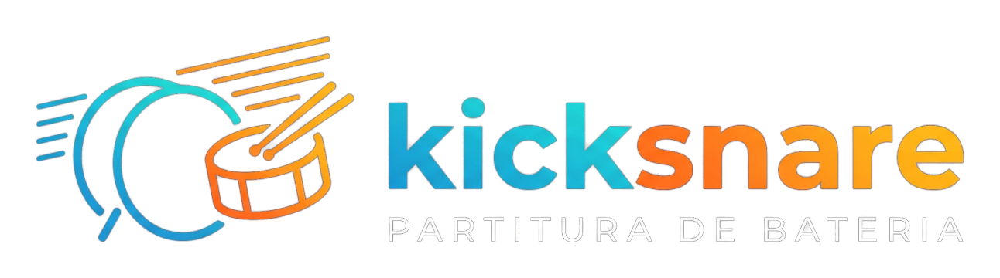

<p align="center"></p>

# Kicksnare

Etapa 1: URL do YouTube ou arquivo local -> `audio.wav` -> `drums.wav`.
Etapa 2: `drums.wav` -> `events.json`, `beats.json`, `score.musicxml`.

```
python3.12 -m venv .venv && .venv/bin/pip install -r requirements.txt
.venv/bin/python spike.py <url | arquivo>
```

`.venv/bin/python transcribe_cli.py <id>`   # id = pasta em data/

Saída em `data/<id>/`. Se o Python for < 3.10 (yt-dlp novo não instala), defina
`KICKSNARE_YTDLP="/caminho/outro/python -m yt_dlp"`. Na VPS use Python 3.10–3.13.
Requer `ffmpeg` no PATH.

## Etapa 3: web + fila

```
pip install -r requirements.txt            # inclui fastapi, uvicorn, python-multipart
.venv/bin/python -m kicksnare.worker       # 1 processo: fila SQLite, 1 música por vez
.venv/bin/uvicorn kicksnare.web:app --host 127.0.0.1 --port 8000
```

- Interface: `http://localhost:8000` (colar URL do YouTube ou enviar áudio).
- `KICKSNARE_PASSWORD` (e `KICKSNARE_USER`, padrão `kicksnare`) ativa login HTTP Basic.
- Dados em `data/<id>/`; banco em `data/kicksnare.db`.
- Na página da música: partitura (OpenSheetMusicDisplay), player e editor de padrões.

## Etapa 4: cursor sincronizado

Na página da música, o cursor acompanha o áudio (compassos de `bars.json`, beats de `beats.json`):

- **Velocidade** 50–100% (mantém o tom), **Ir para compasso**, **Repetir de/até** (com *Marcar início/fim*
  usando o compasso atual), **seguir** (vira a página sozinho) e **Ajuste** em ms para compensar atraso.
- Barra de espaço alterna play/pause.
- O cursor para em cada nota/pausa: ele marca a última nota já tocada, não uma posição contínua.

## Etapa 5: partitura em PDF

Em `/songs/<id>/sheet`: envie o PDF; o Kicksnare detecta as pautas de 5 linhas e as barras de compasso
(sem OMR), você corrige, informa a ordem de execução e, se precisar, âncoras de tempo.

- **Detecção:** barra = linha vertical que cobre a pauta de ponta a ponta, sem passar dos limites
  (hastes passam) e sem cabeça de nota encostada. Pautas de 1 linha não são detectadas.
- **Editar:** marque "editar barras de compasso" e clique na pauta (adiciona) ou numa barra (remove);
  "ignorar pauta" exclui pautas de outros instrumentos.
- **Ordem:** `1-8, 1-8, 9-16, 1-4` ou `1-8 x2, 9-16`. "Usar repetições detectadas" aplica sinais de `|:` `:|`
  simples (sem voltas/D.S.).
- **Âncoras:** clique num compasso, ouça até o ponto certo e use "Ancorar". Entre âncoras, se o número de
  compassos do áudio bate com o da partitura, usa a grade do áudio; senão interpola linearmente.

## Faixas, rolagem e identidade visual

- **Faixa:** o seletor "Faixa" alterna entre *Música original*, *Só a bateria* e *Sem a bateria*, mantendo o
  ponto e a velocidade. `no_drums` sai do Demucs (ou de `mix - bateria`, exato para `--two-stems`).
  API: `/api/songs/<id>/track/{mix,drums,no_drums}.mp3`.
- **Rolagem:** com "seguir" ligado, a página rola para manter o cursor à vista (e vira a página da partitura).
  Rolar à mão suspende a rolagem automática por 4 s.
- **Logo:** `kicksnare/static/logo*.png`, `favicon.png`, `apple-touch-icon.png` (gerados da imagem enviada).

## Deploy

Veja `deploy/README.md` (systemd + nginx, app em um subcaminho como `/kicksnare` via `KICKSNARE_BASE`).

## Licença

Código do Kicksnare: **GNU AGPL-3.0** (veja o arquivo `LICENSE`). Quem hospedar uma versão modificada para
terceiros deve disponibilizar o código-fonte.

## Licenças de terceiros

Este repositório **não inclui** modelos nem dependências; eles são baixados na instalação. Atenção:

- **ADTOF** (pesos do modelo de transcrição): CC BY-NC-SA 4.0, **uso não comercial**.
- Demucs (MIT), beat_this (MIT), yt-dlp (Unlicense), OpenSheetMusicDisplay (BSD-3), pypdfium2 (BSD/Apache),
  music21 (BSD). Confira as licenças antes de redistribuir.
- Baixar áudio do YouTube pode violar os termos do serviço; use apenas com conteúdo seu ou autorizado.
